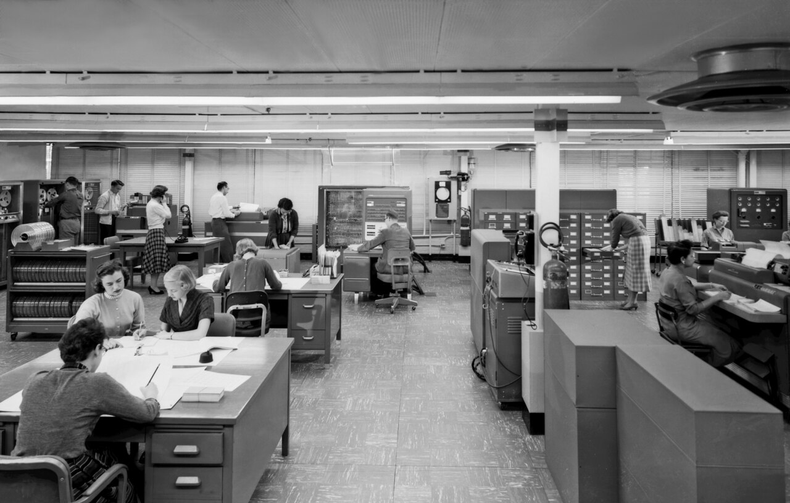
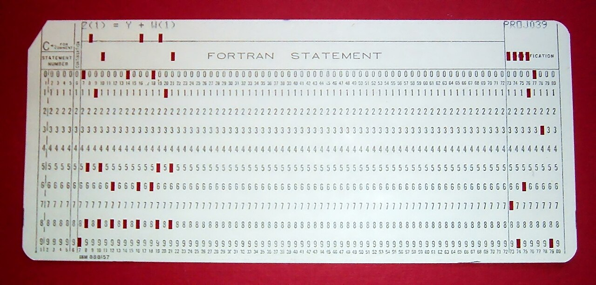
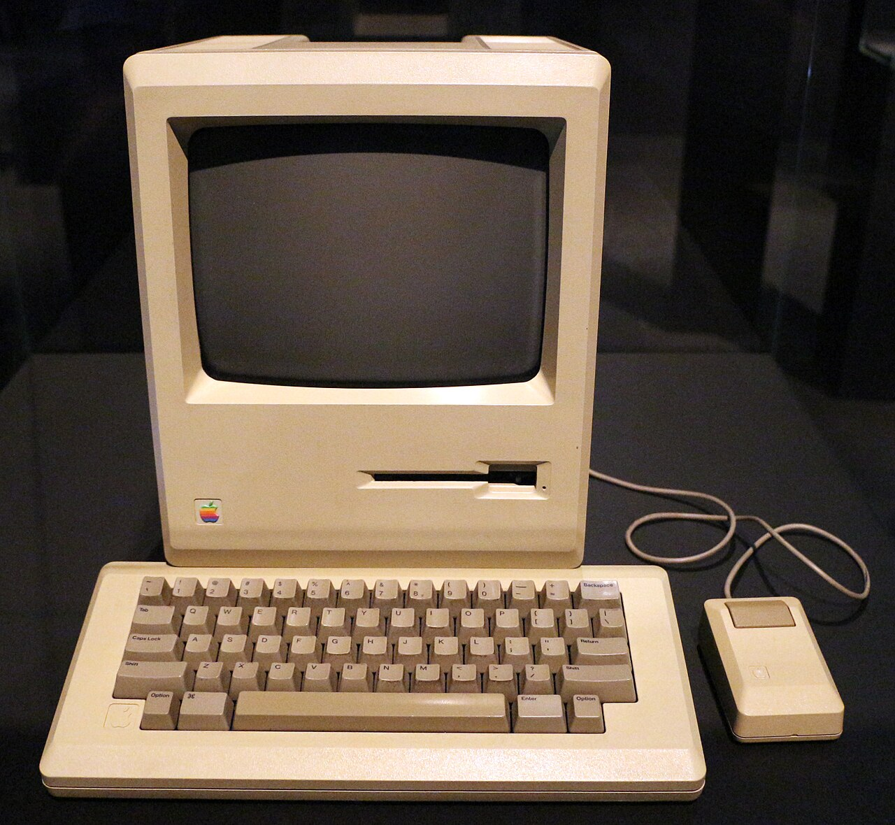
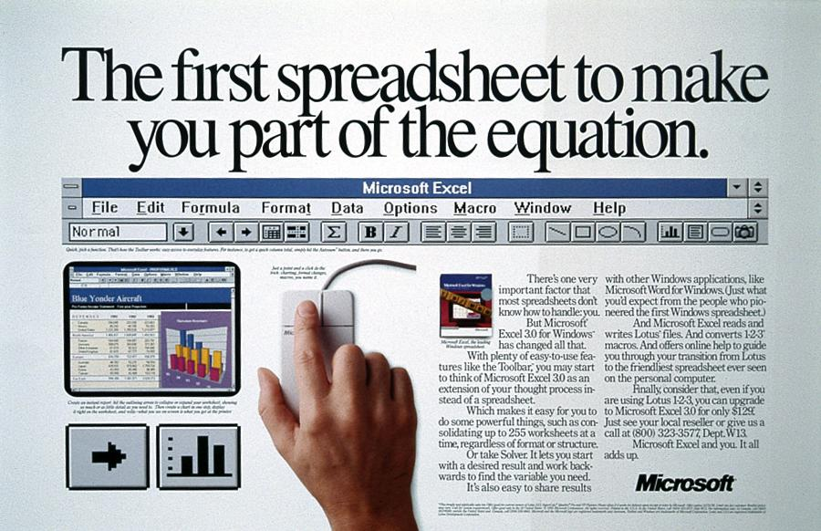
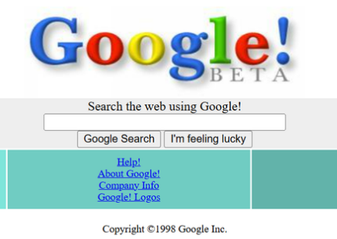
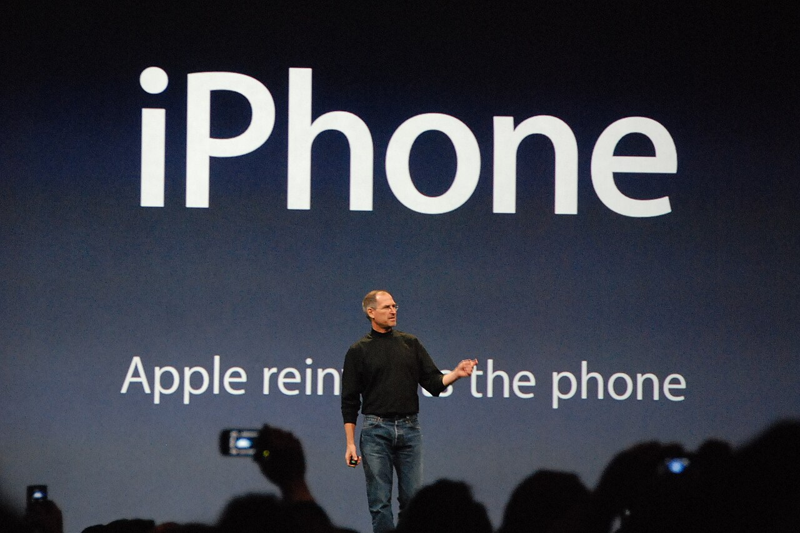
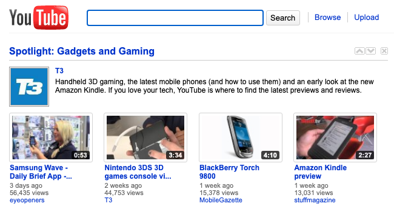

<!-- .slide: class="title" data-background-color="#3A2BE0" -->
# Développeur logiciel : un métier de création

Anthony Dahanne - Colloque des professions du CSSDM - Vendredi 13 Novembre 2026

Les diapos sur ton téléphone

Note:
Dire bonjour, annoncer le plan en une phrase : comment le métier a évolué, comment on travaille en équipe, comment le devenir, et ce que l'IA change.

---

# Salut, moi c'est Anthony!

<b>20 ans</b>de développement en Java

<b>Une dizaine</b>de rôles dans des industries variées : tourisme, finance, outils de déploiement, sécurité logicielle…

<b>Technique</b>une carrière surtout dans le code : en écrire, relire celui des autres, concevoir l'architecture des logiciels

Note:
Me présenter en 20 secondes. Insister sur la variété : le même métier m'a fait travailler dans le tourisme, la finance, la sécurité… Le code est partout, donc les développeurs aussi.

---

<!-- .slide: class="section" data-background-color="#FF7A1A" -->

Partie 1

# Un métier qui évolue tout le temps!

---

# Un dev, c'est quoi?

Pilotage de train, voiture, avionSantéRobotiqueFacturation

L'app de la STMInteracMozaïk

TikTokSpotifyRobloxSnapchatFortnite

Derrière chaque écran que vous touchez aujourd'hui, quelqu'un a écrit du code.

Note:
Demander à la salle : quelles apps avez-vous ouvertes ce matin? Chacune a été écrite, testée et mise en ligne par des gens comme moi.

---

<!-- .slide: data-year="1950" class="with-photos" -->
# Les dinosaures de l'informatique

- Des ordinateurs de la taille d'une classe
- On programme avec des cartes perforées : une carte, une ligne
- Un seul ordinateur pour toute une banque, une compagnie de train

<figure><figcaption>Un IBM 704 à la NACA, l'ancêtre de la NASA (1957)</figcaption></figure>
<figure><figcaption>Une carte = une ligne de code : Z(1) = Y + W(1)</figcaption></figure>

Photos : NASA Langley / NACA, 1957, domaine public · Arnold Reinhold, CC BY-SA 2.5 · Wikimedia Commons

Note:
Expliquer la carte perforée : des trous, pas d'écran. Une erreur de frappe = refaire la carte. L'informatique sert alors à gérer des données : comptes bancaires, horaires, paie.
Photo 1 : la salle de l'IBM 704 au centre de recherche Langley de la NACA (devenue la NASA en 1958), 1957. Une machine = une salle entière, et une équipe pour la faire tourner.
Sources : https://commons.wikimedia.org/wiki/File:IBM_704_Computer_Operations_(LRC-1957-B701_P-05391).tiff (domaine public) ; https://commons.wikimedia.org/wiki/File:FortranCardPROJ039.agr.jpg (Arnold Reinhold, CC BY-SA 2.5, https://creativecommons.org/licenses/by-sa/2.5/).

---

<!-- .slide: data-year="1985" class="with-photos" -->
# L'ordi arrive à la maison

- Le PC familial, Windows, la souris
- Des applications pour écrire et calculer : Word, Excel
- Les premiers jeux vidéo : Mario, Doom, SimCity

<figure><figcaption>Le Macintosh d'Apple, sorti en 1984, avec sa souris</figcaption></figure>
<figure><figcaption>Une pub pour Excel sur Windows (1990)</figcaption></figure>

Photos : Sailko, CC BY 3.0 · Microsoft Sweden, CC BY 2.0 · Wikimedia Commons

Note:
Le développeur ne travaille plus seulement pour les banques : il écrit des logiciels pour tout le monde. Les jeux vidéo deviennent une industrie.
Photo 1 : le premier Macintosh (1984), un des premiers ordinateurs grand public avec une souris et des fenêtres. Photo 2 : une publicité d'Excel 3.0 pour Windows 3.0 (1990) ; on y voit la barre de menus et la barre d'outils, et la souris au centre.
Sources : https://commons.wikimedia.org/wiki/File:Computer_macintosh_128k,_1984_(all_about_Apple_onlus).jpg (Sailko, CC BY 3.0, https://creativecommons.org/licenses/by/3.0/) ; https://commons.wikimedia.org/wiki/File:Excel_For_Windows_3.0_Ad.jpg (Microsoft Sweden via Flickr, CC BY 2.0, https://creativecommons.org/licenses/by/2.0/).

---

<!-- .slide: data-year="1998" class="with-photos" -->
# Tout le monde sur le web

- Amazon.com, Google.com, Wikipédia
- Acheter, chercher, apprendre, depuis chez soi
- Le développeur devient développeur web

<figure style="width:10.5em">

<i></i><i></i><i></i>http://www.google.com/

<figcaption>La page d'accueil de Google en 1998</figcaption></figure>
<figure style="width:15em">

<i></i><i></i><i></i>index.html
<pre class="code">&lt;body bgcolor="#FFFFCC"&gt;
&lt;center&gt;
  &lt;font face="Comic Sans MS" size="6"&gt;
    Bienvenue sur ma page!
  &lt;/font&gt;
  &lt;marquee&gt;Nouveau : mes photos!&lt;/marquee&gt;
  &lt;table border="1"&gt;
    &lt;tr&gt;&lt;td&gt;&lt;a href="photos.html"&gt;Photos&lt;/a&gt;&lt;/td&gt;&lt;/tr&gt;
  &lt;/table&gt;
&lt;/center&gt;
&lt;/body&gt;</pre>
<figcaption>Du HTML comme on l'écrivait en 1998 (reconstitution)</figcaption></figure>

Capture : Google, 1998, domaine public · Wikimedia Commons

Note:
Les sites web sont des programmes qui tournent sur des serveurs. Nouveaux langages, nouvelles contraintes : des millions de visiteurs en même temps.
Image 1 : la vraie page d'accueil de Google en décembre 1998 (encore en « bêta »). Image 2 : une reconstitution du HTML typique de l'époque, qu'on écrivait à la main ou avec des éditeurs comme Dreamweaver : tableaux pour la mise en page, police Comic Sans, texte qui défile avec marquee.
Source : https://commons.wikimedia.org/wiki/File:Google_Main_Page_in_1998.png (domaine public, d'après https://web.archive.org/web/19981202230410/http://www.google.com/), image recadrée.

---

<!-- .slide: data-year="2010" class="with-photos" -->
# Une app dans chaque poche

- iPhone et Android : les applications mobiles
- Instagram, Snapchat, YouTube
- Des millions d'utilisateurs connectés en même temps

<figure><figcaption>Steve Jobs présente le premier iPhone (janvier 2007)</figcaption></figure>
<figure style="width:12em">

<i></i><i></i><i></i>http://www.youtube.com/

<figcaption>YouTube en août 2010</figcaption></figure>

Photo : Blake Patterson, CC BY 2.0 · Wikimedia Commons — Capture : YouTube, août 2010, via la Wayback Machine (Internet Archive)

Note:
Deux téléphones à programmer, des écrans tactiles, la caméra, le GPS. Les réseaux sociaux explosent.
Photo : Macworld, San Francisco, janvier 2007. Steve Jobs annonce l'iPhone : « Apple réinvente le téléphone ». L'App Store arrive l'année suivante, et avec lui des milliers de nouveaux emplois de développeurs mobiles.
Source : https://commons.wikimedia.org/wiki/File:Steve_Jobs_presents_iPhone_(cropped_3-2).jpg (Blake Patterson, CC BY 2.0, https://creativecommons.org/licenses/by/2.0/).
Capture YouTube : https://web.archive.org/web/20100814182336/http://www.youtube.com/ (14 août 2010), recadrée. Image non libre (© Google/YouTube et auteurs des vidéos), utilisée en classe au titre de l'utilisation équitable à des fins d'éducation : ne pas republier la présentation en ligne avec cette image.

---

<!-- .slide: data-year="2023" -->
# L'ère de l'intelligence artificielle

- L'IA aide à écrire, relire et tester le code
- Le métier change encore une fois

Note:
Décrire concrètement ma journée : je décris ce que je veux, l'IA propose, je vérifie, je corrige, je décide. Transition vers la partie 2 : je ne travaille jamais seul.

---

<!-- .slide: class="section" data-background-color="#3A2BE0" -->

Partie 2

# Ma place dans l'équipe

---

# Une équipe, cinq rôles, un projet

  

💡
<b>Chef de produit</b>décide quoi construire

  

📅
<b>Chef de projet / scrum master</b>organise le temps et l'équipe

  

⌨️
<b>Développeurs</b>écrivent le code

  

🔍
<b>QA</b>vérifient que tout fonctionne

  

🎒
<b>Utilisateurs</b>élèves et parents

<b>Le projet :</b> ajouter une notification dans Mozaïk pour prévenir, le matin même, d'une journée sans uniforme obligatoire.

Note:
Présenter les cinq rôles comme des coéquipiers, pas une pyramide : personne n'est le patron de l'autre. Faire voter la salle : quel canal choisiriez-vous pour la notification?

---

# Réfléchir et planifier

  

    <h3>💡 Le chef de produit explore les canaux</h3>
    

      CourrielTeamsInstagram!TextoNotification MozaïkAffiche à l'entréeMessage vocalTikTok
    

  

  

    <h3>📅 Le chef de projet calcule le temps</h3>
    <svg viewBox="0 0 520 190" xmlns="http://www.w3.org/2000/svg" aria-label="Diagramme de chemin critique">
      <defs><marker id="ar" viewBox="0 0 10 10" refX="9" refY="5" markerWidth="7" markerHeight="7" orient="auto-start-reverse"><path d="M0 0L10 5 0 10z" fill="#17162B"/></marker></defs>
      <g stroke="#17162B" stroke-width="4" fill="none" marker-end="url(#ar)">
        <path d="M92 60 H140"/><path d="M92 60 C120 60 120 130 140 130"/>
        <path d="M232 60 H290"/><path d="M232 130 C260 130 260 60 290 60"/>
        <path d="M382 60 H430"/>
      </g>
      <g font-family="Nunito, system-ui, sans-serif" font-size="16" font-weight="700" text-anchor="middle">
        <rect x="10" y="38" width="82" height="44" rx="10" fill="#FF7A1A" stroke="#17162B" stroke-width="4"/><text x="51" y="58" fill="#fff">Décider</text><text x="51" y="76" fill="#fff" font-size="13">2 j</text>
        <rect x="140" y="38" width="92" height="44" rx="10" fill="#C5F23C" stroke="#17162B" stroke-width="4"/><text x="186" y="58">Coder</text><text x="186" y="76" font-size="13">5 j</text>
        <rect x="140" y="108" width="92" height="44" rx="10" fill="#39C0F5" stroke="#17162B" stroke-width="4"/><text x="186" y="128">Textes</text><text x="186" y="146" font-size="13">1 j</text>
        <rect x="290" y="38" width="92" height="44" rx="10" fill="#FF5CA8" stroke="#17162B" stroke-width="4"/><text x="336" y="58" fill="#fff">Tester</text><text x="336" y="76" fill="#fff" font-size="13">2 j</text>
        <rect x="430" y="38" width="82" height="44" rx="10" fill="#3A2BE0" stroke="#17162B" stroke-width="4"/><text x="471" y="58" fill="#fff">Livrer</text><text x="471" y="76" fill="#fff" font-size="13">1 j</text>
      </g>
      <path d="M10 170 H512" stroke="#FF7A1A" stroke-width="6" stroke-dasharray="14 8"/>
      <text x="261" y="186" font-family="Nunito, system-ui, sans-serif" font-size="13" text-anchor="middle" fill="#4a4870" font-weight="700">Chemin critique : 10 jours — si Coder prend du retard, tout le projet recule</text>
    </svg>
    
Qui est disponible? Les deux devs sont en vacances la semaine 3…

  

Note:
Le chef de produit pense d'abord aux utilisateurs : où regardent les élèves le matin? Le chef de projet enchaîne les tâches et repère celles qui bloquent les autres (le chemin critique). Les textes peuvent se faire en parallèle du code.

---

# Du projet au déploiement

  <svg class="flow" viewBox="0 0 1000 300" preserveAspectRatio="none" xmlns="http://www.w3.org/2000/svg">
    <path d="M95 95 L300 95 L300 155 L505 155 L505 215 L710 215 L710 275 L870 275" fill="none" stroke="#3A2BE0" stroke-width="5" stroke-dasharray="12 10" opacity=".45"/>
  </svg>
  
<b>Idée et besoin</b>
ProduitUtilisateurs

  
<b>Planification</b>
Projet

  
<b>Code</b>
Devs

  
<b>Test</b>
QADevs

  
<b>Déploiement</b>
DevsQA

…puis les <b>utilisateurs</b> reçoivent la notification, donnent leur avis, et on recommence avec une nouvelle idée.

Note:
Chaque étape a ses responsables, mais tout le monde reste en contact. Dans la vraie vie on boucle plusieurs fois : les retours des utilisateurs relancent une nouvelle idée.

---

<!-- .slide: class="section" data-background-color="#39C0F5" -->

Partie 3

# Devenir développeur logiciel

---

# Les chemins au Québec

<b>Secondaire</b>Vous êtes ici

<b>Cégep</b>DEC technique (3 ans) ou DEC préuniversitaire (2 ans)

<b>Université</b>Génie logiciel, informatique

Mon parcours : classe préparatoire puis école d'ingénieur, en France. Un autre chemin, même métier.

Note:
Le DEC technique (3 ans) mène directement au travail ou à l'université. Le DEC préuniversitaire (2 ans) mène au bac en génie logiciel ou en informatique. Les deux fonctionnent. On regarde chaque étape de plus près.

---

# Le cégep : deux portes d'entrée

3 ans
<b>DEC technique</b>
Techniques de l'informatique (420.B0)

Bois-de-BoulogneAndré-Laurendeau

Session 1, par exemple :

<ul><li>Bases de la programmation</li><li>Ordinateurs et systèmes d'exploitation</li><li>Mathématiques appliquées à l'informatique</li></ul>

→ un stage, puis le marché du travail… ou l'université

2 ans
<b>DEC préuniversitaire</b>
Sciences, informatique et mathématique (200.C1) ou Sciences de la nature (200.B1)

Bois-de-BoulogneMaisonneuveDawsonVanier

Session 1, par exemple :

<ul><li>Introduction à la programmation</li><li>Calcul différentiel</li><li>Probabilités et statistique</li></ul>

→ l'université

💡 Astuce : maths SN ou TS, chimie et physique en 5e secondaire, et toutes les portes restent ouvertes.

Note:
Exemples de cours : session 1 de 420.B0 au Cégep André-Laurendeau (grille cohorte A2024) ; session 1 de 200.C1 à Bois-de-Boulogne (prospectus 2026-2027). Le DEC technique mène aussi à l'université : passerelles DEC-BAC avec reconnaissance de cours (UQAM, UdeM, Polytechnique), et l'ÉTS accepte le 420.B0 directement. À l'université, la sélection se fait avec la cote R : une note qui tient compte de la force du groupe. Les seuils varient selon les années (vérifier avant la présentation).

---

# Les universités francophones

<b>UQAM</b>
Bac en informatique et génie logiciel
3 ans

Au début du bac :

<ul><li>Programmation I</li><li>Mathématiques pour l'informatique</li><li>Utilisation et administration des systèmes informatiques</li></ul>
Option coop : 3 stages payés

<b>Université de Montréal</b>
Bac en informatique
3 ans

Au début du bac :

<ul><li>Programmation 1</li><li>Design et développement Web</li><li>Structures discrètes en informatique</li></ul>
Option coop : 3 stages en entreprise

🛠️ Ingénieur ou pas, on peut devenir développeur ! Pour le titre d'ingénieur : génie logiciel à Polytechnique ou à l'ÉTS, ou le BEng à Concordia et McGill.

Note:
UQAM 7316 : cours de la 1re session du cheminement régulier (INF1120, INF1132, INF1070). Régime coop (7416) : 3 stages rémunérés de 15 semaines. Cote R minimale publiée : 22.
UdeM 1-175-1-0 (DIRO) : cours obligatoires de 1re année (IFT1015, IFT1005, IFT1065) ; l'ordre exact par session n'est pas publié. Cote R minimale publiée : 25.
Polytechnique : bac en génie logiciel, 120 crédits, stage obligatoire. ÉTS : bac en génie logiciel, 3 stages obligatoires et rémunérés, conçu pour les diplômés du DEC technique.
Titre d'ingénieur (protégé, bac agréé BCAPG requis) : le bac UQAM « ne conduit pas à l'obtention du titre d'ingénieur » (B.Sc.A.) ; le bac en informatique de l'UdeM non plus (B.Sc.). Oui : Polytechnique, ÉTS, BEng Software Engineering de Concordia et de McGill. L'ÉTS accepte directement le DEC technique 420.B0.

---

# Les universités anglophones

<b>Concordia</b>
Computer Science ou Software Engineering
3 à 5 ans

Au début du bac :

<ul><li>Object-Oriented Programming I</li><li>Mathematics for Computer Science</li><li>Web Programming</li></ul>
Co-op : 3 stages payés

<b>McGill</b>
Computer Science ou Software Engineering
3 ans après le cégep

Au début du bac :

<ul><li>Foundations of Programming</li><li>Introduction to Computer Science</li><li>Discrete Structures</li></ul>
Aucune programmation exigée avant d'entrer

🌍 Cours en anglais : une bonne occasion de pratiquer, l'anglais est partout en informatique.

Note:
Concordia : BCompSc (90 à 120 crédits, 3 à 4 ans) ou BEng Software Engineering (120 à 150 crédits, 4 à 5 ans). Cours : COMP 248 et COMP 232 (automne an 1), SOEN 287 (hiver an 1). Le DEC technique 420.B0 est accepté sans les préalables de maths. Co-op : 3 stages rémunérés de 12 à 16 semaines. Cote R indicative : 25 (26 en maths).
McGill : B.Sc. Computer Science ou Software Engineering, 90 crédits en 3 ans pour un cégépien ; B.Eng. Software Engineering pour devenir ingénieur (115 à 119 crédits). Cours obligatoires de la majeure : COMP 202, COMP 250, MATH 240 (pas un horaire officiel de 1re session). Cote R 2026 : 28 pour le groupe B.Sc. sciences ; 31 pour le B.Eng. Software Engineering.

---

# Les compétences qui comptent

- Maths et logique : découper un problème en petites étapes
- Français et anglais : expliquer, lire, convaincre
- Curiosité : vouloir comprendre comment ça marche
- Persévérance : les bugs finissent toujours par céder
- Travail d'équipe : on ne code jamais seul

Note:
Insister sur la communication : la plus grande partie du travail, c'est comprendre ce que les gens veulent et expliquer ce qu'on fait.

---

<!-- .slide: class="section" data-background-color="#FF5CA8" -->

Conclusion

# Un métier du passé ou de l'avenir?

---

# Des métiers qui ont changé sans disparaître

<b>Bûcheron</b>De la hache à l'abatteuse

<b>Agriculteur</b>Du cheval au tracteur et aux drones

<b>Ébéniste</b>Des outils à main à la découpe numérique

Note:
Chaque grande technologie a transformé ces métiers : moins de gestes répétitifs, plus de décisions et de maîtrise d'outils. Le développeur suit le même chemin.

---

# L'IA a changé mon métier

- Au début : l'IA complète la ligne de code qu'on est en train d'écrire
- Aujourd'hui : des agents IA jouent des rôles précis, comme une petite équipe
- Le développeur devient coordonnateur et vérificateur

Note:
Analogie : je suis passé de celui qui tape tout à celui qui dirige et relit. Comme un chef de cuisine qui goûte chaque plat.

---

# Si l'IA code, pourquoi apprendre à coder?

- Pour comprendre ce que l'IA produit et la diriger, pas l'inverse
- Devenir un expert sera la clé
- Un outil puissant entre des mains qui savent

Note:
Sans expertise, on ne peut ni juger ni corriger. On subit. Avec, on garde le contrôle.

---

# Retour à notre notification…

Sans expert qui relit le code des agents

<ul>
<li>La notification part aux profs au lieu des élèves et des parents</li>
<li>Les courriels de tout le monde sont envoyés en copie visible</li>
</ul>

Avec un expert : on l'attrape avant la mise en ligne

Note:
Exemple concret et drôle, mais réaliste : ce sont deux vraies catégories de bugs (mauvais destinataire, fuite de données). L'IA peut les produire avec assurance. Quelqu'un doit savoir les repérer.

---

<!-- .slide: class="title" data-background-color="#3A2BE0" -->
# Questions?

Anthony Dahanne

Note:
Laisser 10 minutes. Si silence : « Qui parmi vous a déjà écrit une ligne de code? »
